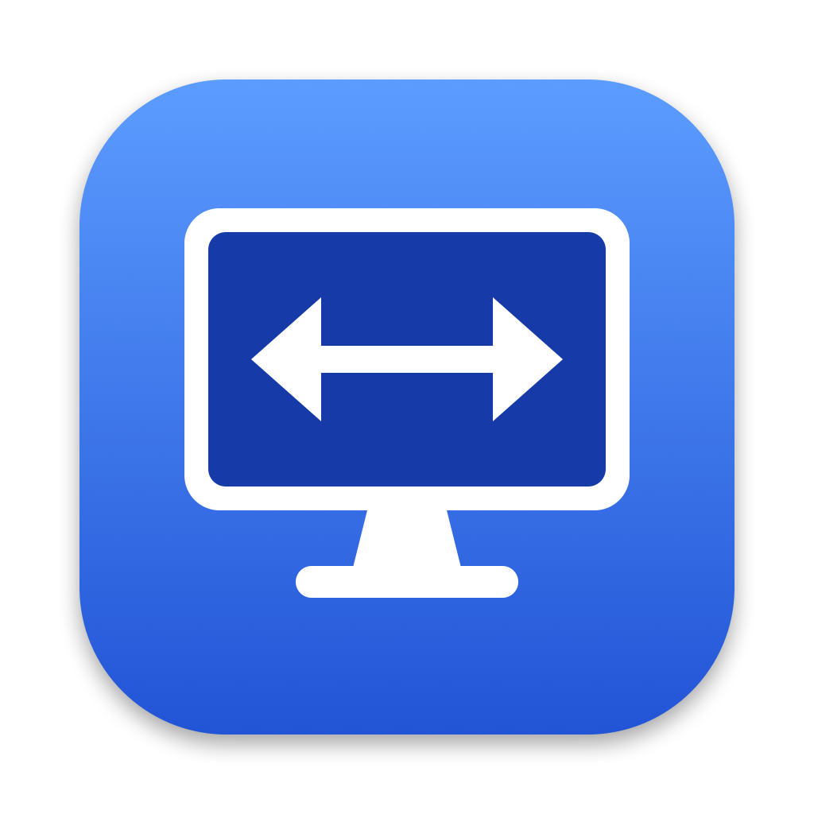

<p align="center">
  
</p>

<h1 align="center">Deskflip</h1>

<p align="center">
  One-click menu bar toggle for macOS natural scrolling.<br>
  For people who switch between a trackpad and a mouse.
</p>

<p align="center">
  <a href="https://github.com/ardakyncu/deskflip/releases/latest"></a>
  
  <a href="LICENSE"></a>
</p>

## Why

Natural scrolling feels right on a trackpad and backwards on a mouse wheel. macOS has only one setting for both: the switch in Trackpad settings and the one in Mouse settings are the same setting, so flipping one flips the other.

If you move between a MacBook on its own and a desk with a mouse, that means a trip to System Settings → Trackpad → Scroll & Zoom every time. Deskflip puts the switch in the menu bar instead: one click when you sit down at your desk, one click when you leave.

## Features

- **One click.** Toggles natural scrolling and applies it immediately, no logout needed.
- **Clear state.** The icon shows whether natural scrolling is on and stays in sync with System Settings.
- **Out of the way.** Lives in the menu bar with no Dock icon. Can open at login.
- **Private.** No network access, no data collection.

## Requirements

macOS 13 Ventura or later, on Apple silicon or Intel.

## Installation

### Download

1. Download `Deskflip-x.y.z.zip` from the [latest release](https://github.com/ardakyncu/deskflip/releases/latest).
2. Unzip it and move `Deskflip.app` to your Applications folder.
3. Open Deskflip. It appears in the menu bar.

Deskflip is open source but not notarized by Apple, so macOS blocks it the first time you open it. To allow it, go to **System Settings → Privacy & Security** and click **Open Anyway**. On macOS 14 and earlier you can also right-click the app and choose **Open**. Alternatively, run:

```bash
xattr -dr com.apple.quarantine /Applications/Deskflip.app
```

### Build from source

Requires Swift 6, included with Xcode 16 or later and with its Command Line Tools (`xcode-select --install`).

```bash
git clone https://github.com/ardakyncu/deskflip.git
cd deskflip
make install
```

This builds the app, installs it to `~/Applications` and opens it. Apps you build yourself are not blocked by macOS.

## Usage

| Action | Result |
| --- | --- |
| Click the menu bar icon | Toggle natural scrolling |
| Right-click or Control-click the icon | Open the menu: Natural scrolling, Open at Login, Quit |

A filled screen in the icon means natural scrolling is on. An outlined screen means it is off.

## How it works

macOS stores natural scrolling in one global preference, `com.apple.swipescrolldirection`. When you click the icon, Deskflip:

1. Saves the new value with `defaults write -g com.apple.swipescrolldirection -bool YES|NO`.
2. Applies it to the running session by calling `setSwipeScrollDirection`, the same function the Trackpad and Mouse panes in System Settings use. It lives in the private `PreferencePanesSupport` framework and is loaded at runtime.
3. Posts `SwipeScrollDirectionDidChangeNotification` so other apps pick up the change.

> [!NOTE]
> Step 2 relies on a private macOS API that Apple could remove in a future release. If that happens, Deskflip still saves the setting, but it takes effect only after you log out and back in. The icon's tooltip tells you when this is the case.

## Uninstall

Turn off **Open at Login** if you enabled it, then quit Deskflip from its menu and delete the app. If you built it from source, `make uninstall` quits and removes it for you.

## Alternatives

- **Shortcuts.** Recent versions of macOS include a built-in Shortcuts action that sets natural scrolling. Deskflip adds an icon that always shows the current state, one-click switching and support back to macOS 13.
- **Per-device scrolling.** If you would rather have the trackpad and the mouse scroll in different directions at the same time, take a look at [Mac Mouse Fix](https://github.com/noah-nuebling/mac-mouse-fix), [Scroll Reverser](https://github.com/pilotmoon/Scroll-Reverser) or [UnnaturalScrollWheels](https://github.com/ther0n/UnnaturalScrollWheels).

## License

Deskflip is released under the [MIT License](LICENSE).
